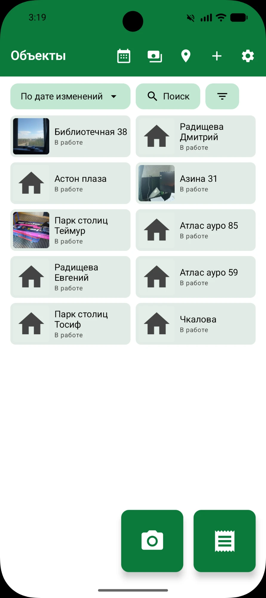
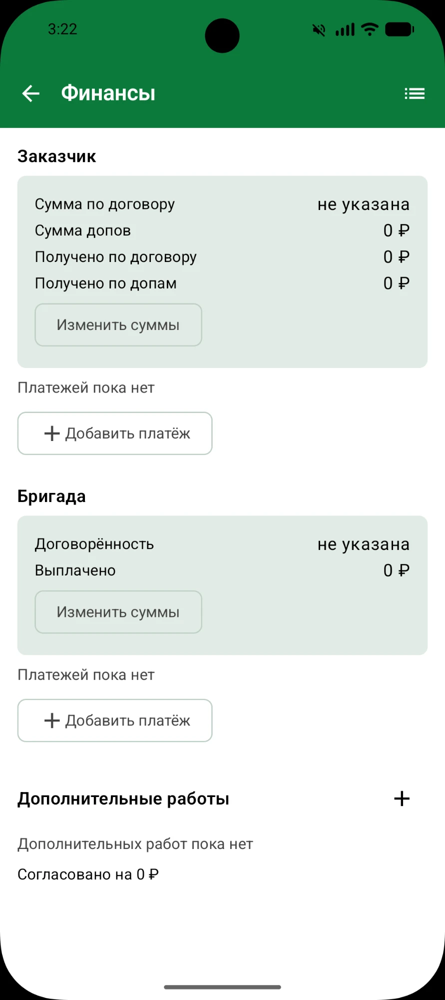
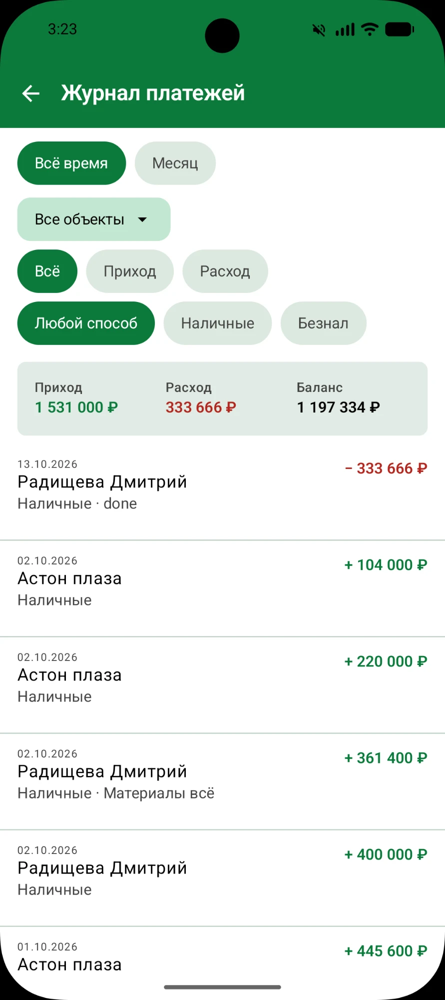
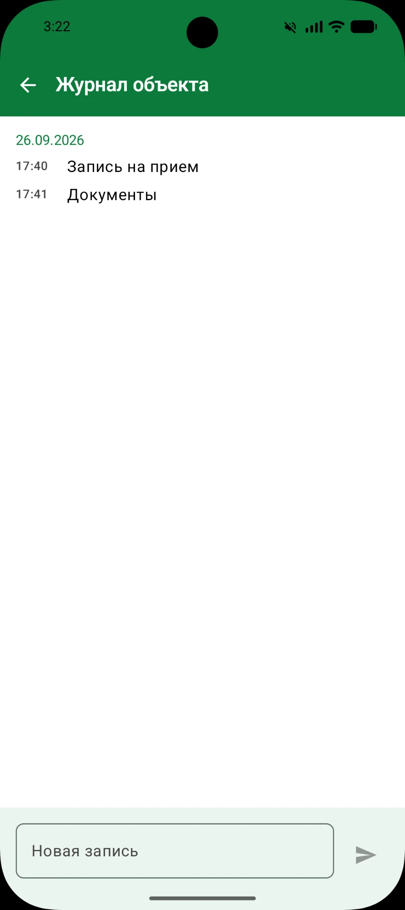
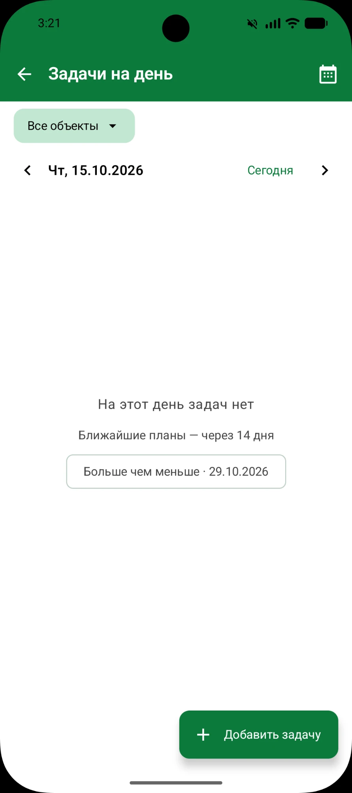
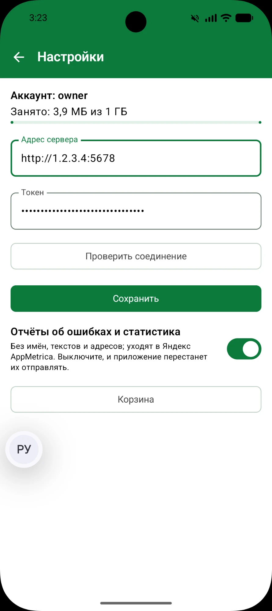

# ProrabPrime

A work-management app for a construction and renovation foreman. It keeps the objects (sites) a foreman
runs, with their receipts and photos, payments, tasks, materials and a map, and it works without a signal.

It is built for a real client, is in production, and is published on RuStore. The app is Android; the same
screens also run in a browser. Kotlin Multiplatform with Compose Multiplatform on the client, a Ktor server
with PostgreSQL behind it.

**Stack:** Kotlin Multiplatform, Compose Multiplatform (Android and Wasm), Koin, Navigation 3, Ktor,
Exposed, Flyway, PostgreSQL, Yandex AppMetrica, GitHub Actions.

**Status:** release 1.5.1, distributed through RuStore ([`docs/RUSTORE.md`](docs/RUSTORE.md)).

- Architecture: [`docs/ARCHITECTURE.md`](docs/ARCHITECTURE.md)
- Why it is built this way: [`docs/DECISIONS.md`](docs/DECISIONS.md)
- Building, testing, branches and commits: [`CONTRIBUTING.md`](CONTRIBUTING.md)

The user interface is in Russian, because the client is.

## What it does

<p>
  
  
  
  
  
  
</p>

- **Objects.** A grid of sites with search, status filters and sorting. Each object has a card with its
  client and other contacts (tap to call), a link to its chat, and a status.
- **Photos and receipts.** A large camera button shoots first and asks which object the picture belongs to.
  Photos and receipts have a gallery and a viewer. Several pictures can be selected and shared to a
  messenger in one go.
- **Expenses and paid receipts.** A list of an object's receipts, split into unpaid (what is owed) and paid
  (the archive), with a materials / crew filter, totals, and marking one or many receipts as paid.
- **Finance.** Per object: payments to the crew and from the client, extra works, agreed sums and a
  history.
- **Payments journal.** One combined journal across all objects, filtered by object, period (all time or a
  month), income or expense, and cash or non-cash, with income, expense and balance totals.
- **Object journal.** Dated notes on what was done and what to remember.
- **Tasks and day plan.** A calendar of tasks per day, optionally filtered by object, with reminders (an
  Android feature; the browser has no alarms).
- **Materials.** A checklist per object.
- **Map.** Objects on OpenStreetMap; an address can be typed or picked on the map.
- **Offline.** The app keeps its own copy of what it shows; photos, receipts and notes made without a
  signal wait in a queue and are sent when a network is back (see "Working without a signal").
- **Trash.** Deleted objects, photos and receipts stay restorable for thirty days.
- **Accounts.** One server can hold several people, each with their own data (see "Accounts for other
  people").
- **Web app.** The same Compose UI compiled to WebAssembly, served by the server.

## How it is built

The code is split into Gradle modules with one-way dependencies. The shared core is Kotlin Multiplatform:
domain and data code are written once and used by the Android app and the web client. The UI is Compose
Multiplatform, so Android and the browser (Kotlin/Wasm) render the same screens. Each screen follows one
MVI shape (state, event, state holder, view model, screen) and lives in its own `feature` module that
never depends on another feature.

The server is Ktor on Netty with Exposed for data access, Flyway for migrations and PostgreSQL. The DTOs and
API paths live in one shared `api-contract` module that both the server and the client compile against, so
they cannot drift apart.

```text
:app                  Android entry point (Application, MainActivity)
:shared               App(), navigation, DI wiring
:web                  browser entry point (Kotlin/Wasm)
:feature:*            one module per screen group: objects, finance, journal, expenses, tasks,
                      materials, map, settings, trash, sync
:core:designsystem    theme and shared components
:core:ui              ViewModel-facing primitives
:core:data            Ktor client, repositories, local storage, platform code
:core:domain          models, repository interfaces, use cases (depends on nothing)
:core:testing         shared fakes for tests
:api-contract         DTOs and API paths shared by client and server
:server               Ktor + Exposed + Flyway + PostgreSQL
```

The rules and the reasons behind them are in [`docs/ARCHITECTURE.md`](docs/ARCHITECTURE.md) and
[`docs/DECISIONS.md`](docs/DECISIONS.md) (a numbered record of each decision, with the alternatives that
were rejected).

**Testing and CI.** `./gradlew verify` runs ktlint, detekt, every unit test, builds the `dev` debug APK and
the web site. GitHub Actions runs the same command on every pull request and on pushes to `dev` and `main`.
Server tests run against PostgreSQL in Docker, or an embedded one when Docker is missing.

**Crash reporting and analytics.** The Android app reports crashes (Java, native and ANR) and a short list of
usage events to Yandex AppMetrica. Events carry no text, names, amounts or ids ([`docs/ANALYTICS.md`](docs/ANALYTICS.md)),
and the user can switch the reporting off in the app's settings. Builds without a key, and the browser
client, report nothing. See ADR-0029 in [`docs/DECISIONS.md`](docs/DECISIONS.md).

## Run it yourself

### What you need

- **JDK 17 or newer** to start Gradle. The build provisions JDK 17 for itself.
- **Android SDK** (Android Studio installs it), with `sdk.dir` in `local.properties`.
- **Docker** — optional. Without it the server runs over an embedded PostgreSQL (below).

The same screens run in a browser: the server serves the web app (Kotlin/Wasm, Compose), see
[the web app](#the-web-app) below.

### 1. Configure the server

Copy `.env.example` to `.env` and replace every `change-me`:

```bash
cp .env.example .env
```

`API_TOKEN` is what the phone sends with every request: make it a long random string. One way:

```bash
python -c "import secrets; print(secrets.token_urlsafe(24))"
```

`.env` is gitignored; it never leaves the computer.

**Map pins.** To put an object on the map the server looks its address up on OpenStreetMap's
public Nominatim, which means **the address is sent to nominatim.openstreetmap.org**. If you would
rather keep addresses on this computer, set `GEOCODER_URL=off` in `.env`: objects then have no pins.
An address can be typed or chosen on the map ("Выбрать на карте" in the object form). Addresses
without a city are resolved around Yekaterinburg; change the point with `GEOCODER_NEAR`
(`.env.example`).

### 2. Start the server

**With Docker** — PostgreSQL in a container, the server from Gradle:

```bash
docker compose up -d
```

```bash
./gradlew :server:run
```

Or both in Docker (build the jar first):

```bash
./gradlew :server:buildFatJar
```

```bash
docker compose --profile server up -d --build
```

**Without Docker** — the same server over an embedded PostgreSQL whose data lives in
`data/dev-postgres`:

```bash
./gradlew :server:runDev
```

The server is up when the log says `Responding at ...:8080`. Check it from the computer:

```bash
curl http://localhost:8080/health
```

Photos are stored under `data/uploads` (gitignored).

### 3. Find the computer's address

For a local setup the phone reaches the server at the computer's address in the local network.

- **Windows:** run `ipconfig` and take the *IPv4 Address* of the Wi-Fi (or Ethernet) adapter,
  e.g. `192.168.1.10`.
- **macOS / Linux:** `ipconfig getifaddr en0` or `hostname -I`.

The server address for the app is then `http://192.168.1.10:8080`.

On Windows, the firewall asks the first time the server starts whether Java may accept
connections; allow it for **private** networks. If the phone still cannot connect, check that
port 8080 is allowed for private networks in *Windows Defender Firewall → Allow an app*.

From the Android emulator the computer is `http://10.0.2.2:8080`.

### 4. Build and install the app

The app has three flavors, and each starts on a server of its own (it can always be changed in the app's settings):

| Flavor | For | Server | Token |
| --- | --- | --- | --- |
| `dev` | your own builds | `prorab.dev.serverUrl`, else `http://10.0.2.2:8080` | `prorab.dev.apiToken` |
| `client` | a customer's APK | `https://prorabprime.duckdns.org` | `prorab.client.apiToken`, required for release |
| `rustore` | the store | `https://prorabprime.duckdns.org` | none |

Put the values in `local.properties`:

```properties
prorab.dev.serverUrl=http://192.168.1.10:8080
prorab.dev.apiToken=the same value as API_TOKEN in .env
prorab.client.apiToken=the customer's token
# Optional: the AppMetrica API key of a flavor, for release builds only; without it nothing is reported.
prorab.rustore.appmetricaKey=the key of the AppMetrica app
```

A flavor's AppMetrica key is `prorab.<flavor>.appmetricaKey`, or `PRORAB_<FLAVOR>_APPMETRICA_KEY` in the environment.
A flavor's `serverUrl` can be overridden the same way (`prorab.client.serverUrl`, `prorab.rustore.serverUrl`), and a
`-P` Gradle property wins over `local.properties`. With the phone connected over USB (developer options and USB
debugging on):

```bash
./gradlew :app:installDevDebug
```

Or build the APK and copy it to the phone:

```bash
./gradlew :app:assembleDevDebug
```

The file is `app/build/outputs/apk/debug/app-debug.apk`.

**Use the debug build on a home network.** The local server speaks plain HTTP, which only the debug build
allows; the release builds need HTTPS (see "HTTPS" below).

### 5. First launch

1. On Android 17 and newer the app asks for access to **devices on the local network**:
   allow it, or it cannot reach the server (ADR-0009).
2. Open **Настройки** (the gear on the list), enter the server address and the token, tap
   **Проверить соединение** — it should answer *Соединение есть, токен принят* — then
   **Сохранить**.
3. Back on the list, add the first object with **Добавить объект**.

With a local server the phone and the computer must be on the same Wi-Fi network; a server behind HTTPS (see
"HTTPS" below) can be reached from anywhere.

### Accounts for other people

One server can hold several people, each with their own objects and tasks that nobody else sees. The
`API_TOKEN` in `.env` is your own token (the first account, `owner`, which has everything made before accounts
existed). For anybody else you make an account from the command line; there is no sign-up page and no password:

```bash
./gradlew :server:admin --args="user add Иван" -q      # makes the account and prints its token, once
./gradlew :server:admin --args="user token Иван" -q    # another token for the same account (a second phone)
./gradlew :server:admin --args="user copy owner Заказчик" -q   # a new account with a copy of what owner has
./gradlew :server:admin --args="user revoke Иван" -q   # takes every token away; the data stays
./gradlew :server:admin --args="users" -q              # lists the accounts
```

`user copy <from> <to>` makes the account `<to>` and gives it a copy of everything live in `<from>` (objects, photos
and receipts with their files, contacts, finance, materials, tasks; not the trash), under new ids, so the two never
share anything and a change in one never reaches the other. It is all or nothing, it needs `STORAGE_DIR` (the
same `.env`, so run it on the computer that holds the files), and the names must be single words.

Give the token to the person: they type it, with the server address, into the settings of the app. A lost
token is replaced with `user token` (and the old one taken with `user revoke` first, if it may be in other
hands). In Docker the same commands are
`docker compose exec server java -cp app.jar ru.prorabprime.server.admin.AdminKt user add Иван`.

**What this does and does not do.** It separates people *inside the app*: one account never sees, changes or
guesses at another's objects, photos, receipts, finance, tasks or trash. It is not privacy from whoever runs
the server: the database and the files are on that computer, and its owner can read them there. A person who
wants nobody else to see their data runs their own server.

Each account has a room for pictures, one gigabyte unless `ACCOUNT_QUOTA_MB` in `.env` says otherwise (`off`
for none). The app shows the name of the account and how much is used in its settings. The trash counts, since
its files are kept for thirty days; **Настройки → Корзина → Очистить** gives the room back (ADR-0022).

### A signed release APK

The release build is signed with a key that stays on your computer. Make it once (the JDK that comes
with Android Studio has `keytool`) and **keep the file and both passwords safe: a phone only accepts an
update signed with the same key, and a lost key cannot be replaced**:

```bash
keytool -genkeypair -v -keystore prorab-release.jks -alias prorab -keyalg RSA -keysize 4096 -validity 10000
```

Put it outside the repository or next to it (`*.jks` is gitignored), and tell Gradle where it is in
`keystore.properties` (gitignored too):

```properties
storeFile=prorab-release.jks
storePassword=...
keyAlias=prorab
keyPassword=...
```

On a build machine the same four values come from `PRORAB_STORE_FILE`, `PRORAB_STORE_PASSWORD`,
`PRORAB_KEY_ALIAS` and `PRORAB_KEY_PASSWORD`. Then:

```bash
./gradlew :app:assembleClientRelease     # the customer's APK, with his token inside
./gradlew :app:assembleRustoreRelease  # the store's APK, no token
```

build `app/build/outputs/apk/<flavor>/release/app-<flavor>-release.apk`. Without a key the same tasks produce an
unsigned APK, which a phone will not install.

**The `client` APK carries his token**: give it to him only. The `rustore` APK carries no token, so it is the one for
anybody else (GitHub, a store); the token is typed in the settings.

The release builds speak only HTTPS (see "HTTPS" below); over plain HTTP on the home network use `dev` debug.

### Checking a change

```bash
./gradlew verify
```

Formatting, static analysis, every unit test and the `dev` debug APK; the server's PostgreSQL tests run
in Docker, or over embedded PostgreSQL when Docker is missing (ADR-0006, ADR-0007). See
[`CONTRIBUTING.md`](CONTRIBUTING.md).

### HTTPS, to reach the server from anywhere

Plain HTTP works on the home Wi‑Fi and only in the debug build. To use the server from outside, and with
the release build, put HTTPS in front of it. With a public IP address this costs nothing:

1. **A name.** On [duckdns.org](https://www.duckdns.org) make a free name such as `prorab.duckdns.org` and
   point it at your IP. If the address changes now and then, run DuckDNS's small updater so the name follows it.
   (A public IP means the router's outside address equals the one a "what is my IP" site shows; behind a
   provider's shared address this will not work.)
2. **The server stays private.** In `.env` set `HOST=127.0.0.1` and a long random `API_TOKEN`: with the
   server reachable from the internet the token is the only lock. Restart the server.
3. **Caddy.** Download [Caddy](https://caddyserver.com/download), copy `Caddyfile.example` to `Caddyfile`, put
   your name in it, and start it next to the file:

   ```bash
   caddy run
   ```

   It gets the certificate itself and renews it. To start it with Windows, `caddy start` as a service or a
   scheduled task at logon does it; the DuckDNS updater and the server want the same.
4. **The router.** Forward ports **80** and **443** to this computer (80 is used only to get the
   certificate), and allow Caddy through the Windows firewall. **Do not** forward 8080.
5. **The app and the site.** In the settings of the app give `https://prorab.duckdns.org` and the token; the
   site is at that address. The release build (see above) works with it.

Check it from outside the home network (a phone on mobile data): the address must show the site, and
`http://<your IP>:8080` must not answer. The computer has to be on, and the server, Caddy and the updater
running, for the app to reach it; without a signal the app still works from its own copy.

### Working without a signal

The app keeps its own copy of everything it shows, so the list of objects, the cards, the finance, the checklist
and the day plan open with no network, and photos, receipts and notes can be made there too. What was made
without a signal waits in a queue (a clock marks it) and goes to the server when a network is back — at once if
the app is open, and by the system's job scheduler if it has been closed. A small line at the bottom says when
there is no signal or something is waiting. If the server refuses a change for good, the line says so and opens a
list where it can be retried or given up on. Pictures seen once are kept for the next time there is none.

The browser version is online-first: its copy lives only while the tab is open.

### The trash

Deleting an object, or a photo or receipt, moves it to the trash instead of removing it. Open it from
**Настройки → Корзина**: every item shows how many days it has left (thirty in all), and can be restored
or removed for good; "Очистить" empties the trash. After thirty days the server removes what is left. The
trash is read from the server, so it needs a signal; deleting itself still works without one (ADR-0019).

### The web app

The web client is the same Compose UI compiled to WebAssembly. It needs a recent browser (Chrome,
Edge or Firefox from the last two years, Safari 18.2+). The server serves it, so the page and the API
share an address and nothing needs CORS.

```bash
./gradlew :web:wasmJsBrowserDistribution
```

builds the site into `web/build/dist/wasmJs/productionExecutable` (the first build downloads Node.js,
Yarn and Binaryen into `~/.gradle`). `.env.example` points `WEB_DIR` at that folder; start the server
and open `http://<this computer>:8080/` in a browser. The first time, open the settings (the gear),
type the API token, and press save: it is kept in that browser's `localStorage`. The server address
is the one the page came from.

In the browser the camera button opens the file chooser (a phone's browser goes straight to the
camera), and the day plan has no alarms: reminders are an Android feature.

